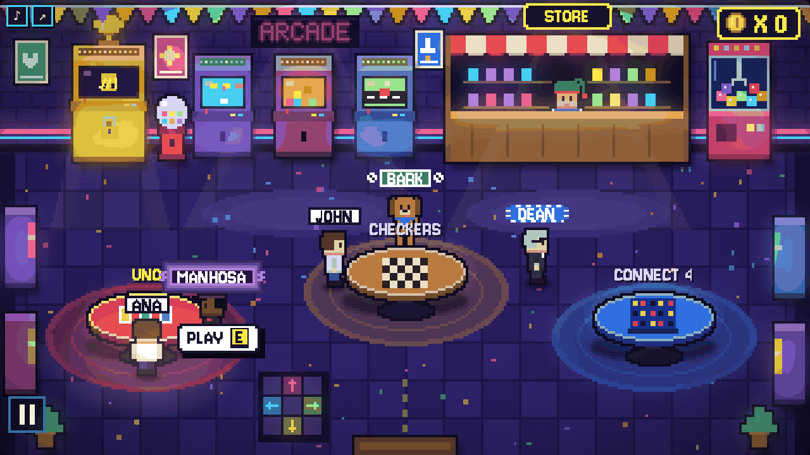

# Arcade Masters

A pixel-art arcade you walk around in. Sit at a table to play **UNO**, **checkers** or **Connect Four** against
bots or against your friends online, win coins, spend them on clothes and name tags in the store, and unlock the
**championship** by winning each game once.

Group project for Introduction to Programming (Nova SBE, 2026/27).



## Deployed app

**https://arcademasters.streamlit.app**

The app runs on Streamlit Community Cloud, from the code of this repository's `main` branch. (It is deployed from
[a fork](https://github.com/Duque03/Duque03-UNO-Project---Intro-to-Programming) kept identical to `main`, because
deploying needs admin rights on the repository.) Saved players live in a hosted PostgreSQL database. On the free
plan the app goes to sleep after a while without visitors: if you see "This app has gone to sleep", press the
button to wake it up and wait about a minute.

## Team

| Name | Student number | GitHub |
|---|---|---|
| _to be added_ | _to be added_ | [Duque03](https://github.com/Duque03) |
| _to be added_ | _to be added_ | [LouisBlondeau00](https://github.com/LouisBlondeau00) |
| _to be added_ | _to be added_ | [ccostamacedo](https://github.com/ccostamacedo) |
| _to be added_ | _to be added_ | _to be added_ |

## Objectives

- Build a complete, playable game in Python that people can open in a browser, with no installation.
- Write the rules of three classic games ourselves (UNO, checkers, Connect Four), with bots of four difficulty
  levels, and test every rule with an accepted and a rejected action.
- Give the player reasons to come back: coins, a store with cosmetics, a wardrobe, and a championship that
  unlocks after winning each game once. Progress is saved under a name and a PIN.
- Add an online mode where friends meet in a lobby, chat and play the same games together.
- Keep the code organised so four people can work on it at the same time (rules, pictures and screens apart),
  and deploy it on the internet.

## What is in the game

- **The arcade room**: walk with the keyboard or by clicking; talk to the bots; the machines, lights and signs move.
- **UNO** (with the big UNO! button and the "Corta UNO" face-off), **checkers** (captures are mandatory) and
  **Connect Four**, each against bots at easy, medium, hard or expert level.
- **Coins** for every win (more for harder bots), a **store** with 42 cosmetics (common 20, rare 100,
  legendary 500 coins) and a **wardrobe** to try them on.
- **Championship**: unlocked after winning each game once; three rounds against three bots; the winner gets
  50 coins and dances on the title screen.
- **Online mode**: create a lobby and share its 4-letter code, or join one. Up to 4 friends walk around the same
  room, chat (with emojis and a word filter) and sit at a table: a game starts when its chairs are full.
- Music for every screen (High / Medium / Low / off), and everything works with the keyboard or the mouse.

## Run the app on your computer

You need Python 3.11 or newer and [uv](https://docs.astral.sh/uv/) (the tool used in class).

```bash
git clone https://github.com/LouisBlondeau00/UNO-Project---Intro-to-Programming.git
cd UNO-Project---Intro-to-Programming
uv sync
uv run streamlit run app.py
```

The game opens at http://localhost:8501. Choose **Create a character**, type a name and a PIN (4 to 8 digits)
twice, make your character, then **Play offline**. Next time choose **I have an account** with the same name
and PIN to continue with your coins, clothes and wins.

Without uv: `pip install -r requirements.txt pytest` and then `streamlit run app.py`.

## Run the tests

```bash
uv run pytest
```

All tests must pass on `main` (GitHub runs them on every push and pull request). Two longer checks play many
random games with the real rules and the real screens:

```bash
uv run python tools/simulate_rules.py --games 1000
uv run python tools/simulate_app.py --games 20
```

## How to play

| Where | Keys and mouse |
|---|---|
| Menus | Arrow keys and **Enter**, or click. **Esc** goes back. |
| Arcade room | **W A S D** or the arrow keys to walk, or click where you want to go. **E** to play at a table, open the store, talk to a bot or start the championship. **I** for the championship rules. **Esc** for the pause menu (wardrobe, How to play, music, play online, leave). **M** turns the music on or off. |
| UNO | Left / Right to choose a card, **Space** or click to play it, **D** to draw, **P** to pass after drawing. **Space** or click presses the big UNO! button. |
| Checkers | Arrow keys move the cursor, **Space** or click picks a piece and moves it to a lit square. |
| Connect Four | Left / Right and **Space**, keys **1 to 7**, or click a column. |
| Online lobby | Walk to a table and press **E** to sit down. **Enter** opens the chat. |

The full list is in the game: **How to play** on the title screen or in the pause menu.

## How the project is organised

```
app.py                 decides which screen to show
arcade/config.py       the numbers you might want to change (prices, rewards, bot strength)
arcade/logic/          the rules: UNO, checkers, Connect Four, store, championship, online lobbies, chat filter
arcade/art/            draws every picture with code (there are no image files)
arcade/screens/        one file per screen: shows the picture and reacts to clicks and keys
arcade/room.py         the arcade room, drawn and animated in the browser
arcade/title_view.py   the title screen and its menus, drawn in the browser
arcade/db.py           saves and loads players (SQLite on a laptop, PostgreSQL online)
arcade/accounts.py     names and PINs (PINs are only stored as salted hashes)
tests/                 tests for the rules and the screens (accepted and rejected actions)
tools/                 the two simulators
docs/game-design.md    what the game must do
docs/deployment.md     how the app and its database are deployed
AGENTS.md              rules for everyone who changes this repository
```

## Where the data is stored

- **On your computer:** players are saved in `data/arcade.db` (SQLite), created on first run and not committed to
  git. Delete it to reset all players.
- **Online:** the free Streamlit host wipes its disk whenever the app restarts, so the deployed game saves players in
  a free hosted PostgreSQL database (Neon). `arcade/db.py` switches automatically when a `DATABASE_URL` secret is
  set in the host's settings. The connection string is never in the repository.
- **PINs** are never stored: only a salted PBKDF2 hash. After 5 wrong PINs a name is locked for a minute.

The step-by-step deployment guide is in [`docs/deployment.md`](docs/deployment.md). To run the online-save tests
against a database you may wipe (never the real one):
`TEST_DATABASE_URL="postgresql://..." uv run pytest tests/test_db_online.py`. Without it they are skipped.

## How we worked

Changes were made on their own branches and merged into `main` through pull requests, with the tests passing.
The work was split into four streams (room and movement, game tables, store and cosmetics, championship, saves
and online), described in [`AGENTS.md`](AGENTS.md). We used AI coding assistants (the commits they wrote are
marked as such in the history) under the rules in `AGENTS.md`: tests for every rule, every change through a pull
request with all tests passing, and the game played by hand after each change.
