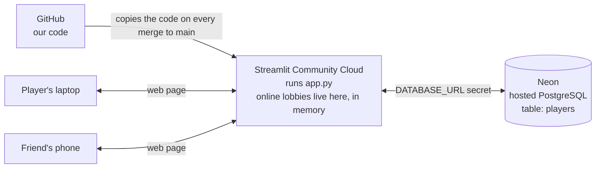

# Putting Arcade Masters online

A guide for the whole team: what each piece is, why we need it, every click to set it up, and the questions we may
be asked in the walkthrough. It takes about 15 minutes and costs nothing (no credit card).

## 1. The big picture

Three things work together:



| Piece | What it is | Why we need it |
|---|---|---|
| **GitHub** | Where our code lives (this repository). | The host reads the code from here, so every merge into `main` reaches the live game. |
| **Streamlit Community Cloud** | A free host that runs `app.py` on its own computer and gives it a web address (`https://something.streamlit.app`). | The course grades a live demo at a URL, and it lets friends play each other: everyone opens the same address, so everyone talks to the same running game. |
| **Neon** | A free PostgreSQL database in the cloud. | The host's disk is wiped every time the app restarts or updates, so the SQLite file we use on our laptops would lose every player. The database keeps them. |

How the game chooses where to save (`arcade/db.py`): if a setting called `DATABASE_URL` exists, it saves in that
PostgreSQL database; if not, it saves in the file `data/arcade.db`, as on our laptops. Same table, same functions.
The table (`players`, one row per name) is created automatically the first time the game starts.

**The secret.** `DATABASE_URL` is the database's address *and password* in one line. Our repository is public, so it
must never be in the code: anyone could read or delete every player. Instead we paste it once into the host's
**Secrets** box, and the game reads it from there (`st.secrets`). On a laptop it would go in
`.streamlit/secrets.toml`, which git ignores.

## 2. Before you start

- A GitHub account that can see the repository. Anyone can see it (it is public), but to deploy it and read its logs
  you should have **write access**: Louis can add you under the repo's *Settings → Collaborators*, or Louis does part 4
  with his own account.
- 15 minutes, and somewhere private to keep the connection string for a minute (a note on your own computer).

## 3. Part one: the database (Neon)

1. Go to **console.neon.tech/signup** and sign up (GitHub, Google or email).
2. Neon asks you to create your first **project**. Name it `arcade-masters`. Keep the default Postgres version and
   region (any region works for us). Create it.
3. You land on the **Project Dashboard**. Click **Connect** (top of the page). A box opens with the connection
   details, already filled in: branch `main`, database `neondb`, and the owner role. Leave **Connection pooling** on.
4. Copy the **connection string**. It starts with `postgresql://` and is one long line. Use the copy button so the
   password (hidden as dots) is copied too.
5. Keep it private. Don't paste it in WhatsApp, in a chat with anyone (Claude included), in a document or in GitHub.
   You'll paste it in exactly one place, in part two. If it ever leaks, Neon can reset the password (the old string
   then stops working, and you paste the new one into the host's Secrets).

## 4. Part two: the app (Streamlit Community Cloud)

1. Go to **share.streamlit.io** and choose **Continue with GitHub**. Allow Streamlit to see your GitHub account.
2. Click **Create app** (top right). When it asks if you already have an app, choose **Yup, I have an app**.
3. Fill in where the game is:
   - **Repository:** `LouisBlondeau00/UNO-Project---Intro-to-Programming`
   - **Branch:** `main`
   - **Main file path:** `app.py`

   (Or click **Paste GitHub URL** and paste
   `https://github.com/LouisBlondeau00/UNO-Project---Intro-to-Programming/blob/main/app.py`.)
4. **App URL:** choose a short, free name, for example `arcade-masters-nova`. This is the address you will show.
5. Click **Advanced settings**:
   - **Python version: 3.12.** Do this now: it cannot be changed after deploying without deleting the app and
     deploying again. (The game is tested on 3.12 and 3.13.)
   - **Secrets:** type exactly one line, with your connection string between the quotes:

     ```toml
     DATABASE_URL = "postgresql://...your string..."
     ```

     The quotes are needed: the box uses the same format as `secrets.toml` (TOML).
   - Click **Save**.
6. Click **Deploy** (at the bottom of the form). The first time takes a few minutes: the log on the right shows the host installing the three
   packages from `requirements.txt` (Streamlit, Pillow, psycopg). Then the title screen appears.

## 5. Part three: check it works

1. **Saving:** choose PLAY OFFLINE, create a player, beat an easy bot (you get coins). Reload the page, choose I HAVE
   AN ACCOUNT and log in again. Your coins are still there: the database works.
2. **Online:** open the address on a laptop and on a phone. PLAY ONLINE on both, create a lobby on one, type its code
   on the other, pick Connect Four, start, and play a few moves.
3. **Seeing the data (good for the demo):** in Neon, open your project → **Tables** (or the **SQL Editor** and run
   `SELECT name, updated_at FROM players;`). Each player is one row: the name, the player saved as JSON text
   (coins, items, wins...) and when it was last saved. The PIN is not in there, only a salted hash of it.

## 6. After it's live

- **Updates:** every merge into `main` reaches the live game by itself within a minute or two. If it doesn't, open
  the app's menu (**Manage app**, bottom right of the live page, or the ⋮ next to the app on share.streamlit.io) and
  choose **Reboot**.
- **Before the presentation:** open the link 5 minutes early. The free host puts an app to sleep after about 12 hours
  without visitors; the first visit wakes it up (it takes a short moment).
- **Changing the secret:** share.streamlit.io → ⋮ next to the app → **Settings** → **Secrets** → edit → **Save**.
  The app restarts by itself.
- Put the address in `README.md` (section "Deployed app").

## 7. If something goes wrong

| What you see | Most likely cause | What to do |
|---|---|---|
| The log shows an error while installing | The wrong Python version | Delete the app and deploy again with Python 3.12. |
| An error page mentioning `connection`, `password` or `authentication` | The secret is wrong: missing quotes, part of the string, a space | Fix it in Settings → Secrets → Save. |
| Players disappear after the app restarts | The secret is missing, so the game saved in a file on the host | Add `DATABASE_URL` in Settings → Secrets. |
| A lobby vanished | The app restarted or woke from sleep | Create a new lobby. Players and coins are safe in the database. |
| "Create app" can't find the repository | Your GitHub account has no access | Ask Louis to add you as a collaborator, or let him deploy. |

## 8. Questions we may be asked (short answers)

- **Where is the data stored?** In a hosted PostgreSQL database (Neon), table `players`: one row per name, with
  the player as JSON text (coins, items, wins, championships, the PIN's hash) and the time it was last saved. On a laptop the same table is in a SQLite file.
- **Why not the file, like on the laptop?** The host's disk is temporary: it is wiped when the app restarts or updates.
- **Why isn't the connection string in the code?** The repository is public. Whoever has the string can read and
  change the database, so it lives only in the host's Secrets (and in an ignored file on a laptop).
- **Are PINs safe?** They are never stored: only a salted PBKDF2 hash, and 5 wrong PINs lock the name for a minute.
- **How can friends play each other?** Everyone opens the same address, so all their browsers talk to the same
  running program. The lobbies are one shared object in that program (`arcade/logic/lobby.py`, shared with
  `st.cache_resource`), protected by a lock. Each browser asks once a second whether the lobby changed, and every
  move is checked on the server with the same rules as the arcade.
- **What if two players click at the same time?** The lock makes the moves happen one after the other; a move that
  is not that player's turn is refused.
- **What if the server restarts?** Players are safe (database). Open lobbies are lost (they live in memory).
- **Limits?** The free host sleeps after ~12 hours with no visitors and has about 1 GB of memory: plenty for a class.
